# Leaseguard Code Flow

This document explains how the project code works internally. It is not a user manual for the public API. File references point to the TypeScript source that implements each part of the flow.

## Module Map

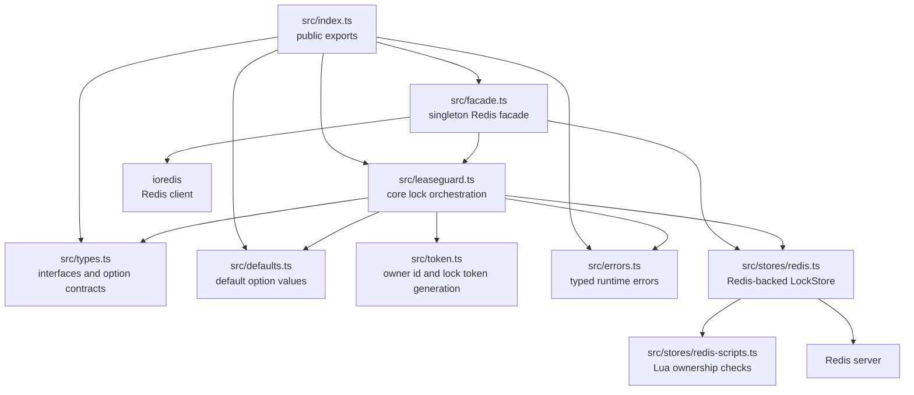

## Responsibilities

`src/index.ts` is the public export surface. It exposes the singleton `lock`, defaults, error classes, and public types.

`src/facade.ts` owns the high-level Redis setup path. `LeaseguardFacade.setup()` creates an `ioredis` client, wraps it in `RedisLockStore`, creates one `Leaseguard` instance, and stores both the Redis client and core instance for later `lock.run()` calls.

`src/leaseguard.ts` is the core state machine. It normalizes options, acquires locks through a `LockStore`, creates the execution context, starts renewal, runs the task, handles timeout and abort signals, emits hooks, and releases the lock in `finally`.

`src/stores/redis.ts` adapts Redis to the `LockStore` interface. `acquire()` uses `SET key token PX ttl NX`. `renew()` and `release()` use Lua scripts so Redis checks ownership and mutates the key atomically.

`src/stores/redis-scripts.ts` holds the Lua scripts. Both scripts compare the stored token with the caller token before changing the key.

`src/types.ts` defines the contracts between the core and any storage implementation: `LockStore`, lifecycle hooks, options, `LockContext`, and `LockHandle`.

`src/token.ts` creates the process owner id and per-lock token. The owner id is stable for a `Leaseguard` instance, while every acquisition gets a fresh UUID token.

`src/errors.ts` defines typed failures used by the core flow.

## Setup Flow

The package has two construction paths:

1. The facade path, used by `lock.setup(redisUrl)`.
2. The direct constructor path, used by tests or custom stores: `new Leaseguard({ store })`.

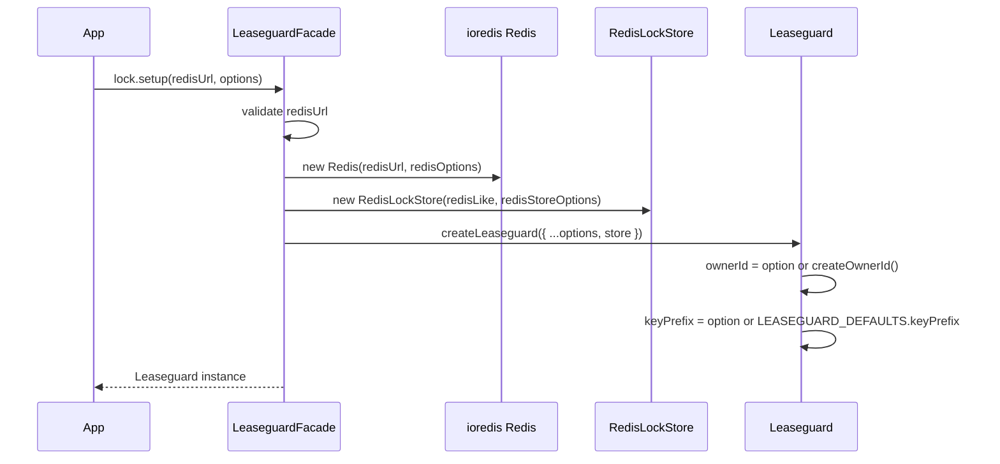

`toRedisLike()` in `src/facade.ts` narrows the `ioredis` client to the small shape needed by `RedisLockStore`: `set`, `eval`, and `get`. This keeps the store implementation independent from the full Redis client type.

## Main `run()` Flow

`Leaseguard.run()` wraps task execution with lock acquisition, automatic renewal, timeout handling, hook emission, and release.

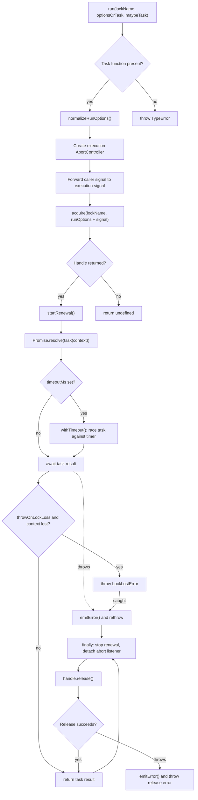

Important detail: release happens in a `finally` block, so the core attempts cleanup after successful tasks, thrown task errors, timeouts, and lock-loss errors.

## Option Normalization

The core never reads raw user options throughout the execution path. It first converts partial options into complete normalized option objects.

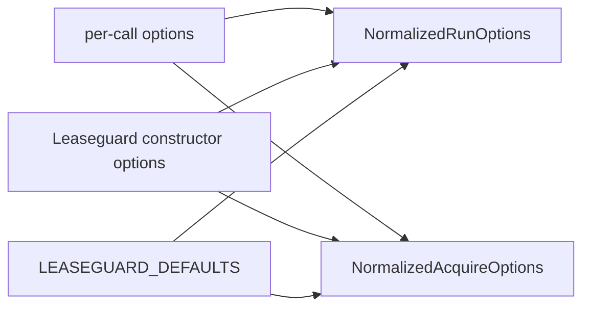

Precedence is:

1. Per-call options, such as `ttlMs` passed to `run()` or `acquire()`.
2. Instance defaults, such as `defaultTtlMs` passed to `new Leaseguard(...)`.
3. `LEASEGUARD_DEFAULTS`.

For `run()`, the renewal interval defaults to the configured `defaultRenewIntervalMs` or one third of the TTL, with a lower bound from `renewIntervalFloorMs`.

## Acquisition And Retry Flow

`acquire()` is the lower-level path that returns a `LockHandle` when the lock is acquired, `undefined` when it is skipped, or throws when configured to throw on lock unavailability.

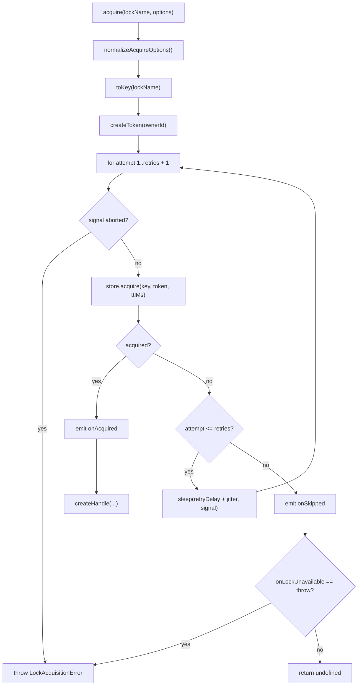

`toKey()` rejects empty lock names and builds the storage key as:

```text
${keyPrefix}${lockName}
```

With defaults, `job` becomes `leaseguard:job`.

## Lock Handle And Execution Context

`createHandle()` builds one object that is both:

- A `LockContext`, passed to the user task.
- A `LockHandle`, used internally for renewal and release.

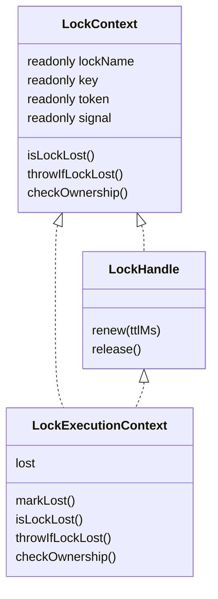

The context tracks lock loss with a local boolean and the execution `AbortSignal`. `isLockLost()` returns true when either the local lost flag is set or the signal is aborted.

`checkOwnership()` calls `store.isOwner(key, token)`. If Redis says the token no longer owns the key, the context marks itself as lost.

## Renewal Flow

`startRenewal()` starts a timer loop after acquisition and before the task is awaited.

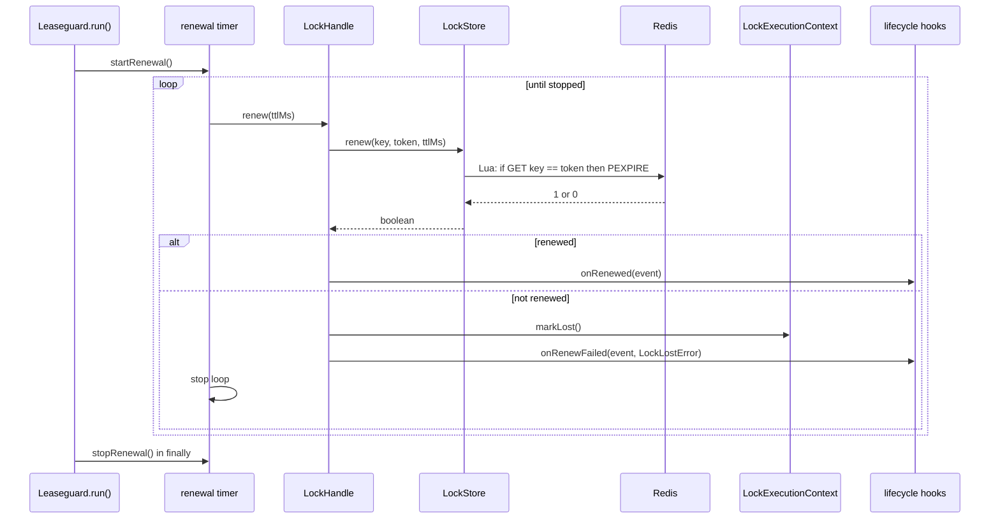

The timer calls `timer.unref?.()` so the renewal timer does not keep the Node.js process alive by itself.

If renewal throws, `startRenewal()` marks the context as lost, emits `onRenewFailed`, and stops scheduling future renewal attempts.

## Timeout And Abort Flow

Timeout handling is implemented with `withTimeout()`, which races the task promise against a timer.

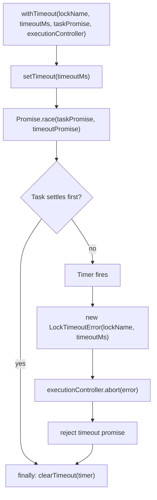

There are two abort sources:

1. A caller-provided `RunOptions.signal`.
2. The internal timeout controller.

`run()` forwards caller aborts into the internal execution controller. The task receives the internal `ctx.signal`, so timeout and caller cancellation share the same task-facing signal.

## Release Flow

Release is called in `run()` after task completion or failure. The handle also prevents duplicate local release calls.

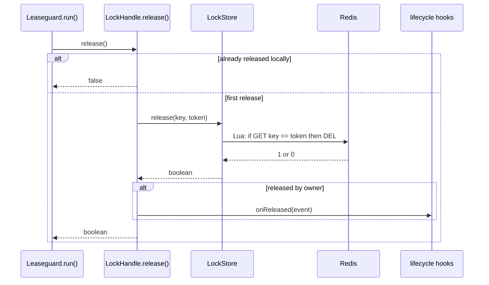

If the store throws while releasing, `release()` wraps that failure in `LockReleaseError`. `run()` then emits `onError` and throws.

## Redis Store Flow

The Redis store is intentionally narrow. It implements only the `LockStore` interface.

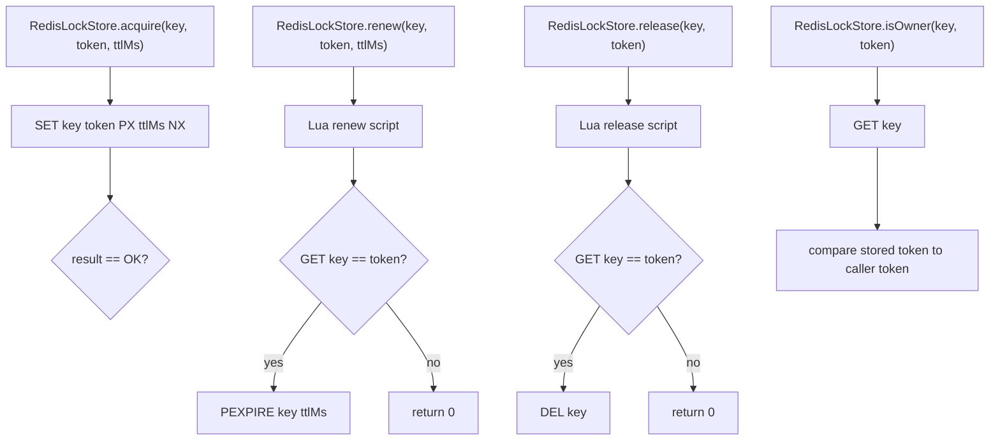

`acquire()` can use a single Redis command because Redis `SET ... NX PX ...` is already atomic. `renew()` and `release()` need Lua scripts because each operation must both check ownership and mutate the key without another client changing the key between those steps.

## Hook Emission

Hooks can be registered globally on the `Leaseguard` instance and locally on a `run()` or `acquire()` call. The core emits the global hook first, then the local hook.

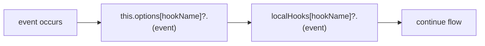

The hook event object includes:

- `lockName`: caller-provided name.
- `key`: storage key after prefixing.
- `token`: owner token when available.
- `attempt`: acquisition attempt number.
- `error`: only for error hooks.

`onSkipped` can omit the token because the lock was not acquired.

## Error Paths

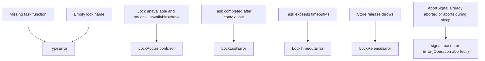

Most task-path errors pass through `emitError()` before being rethrown. Acquisition failures happen before a handle exists, so they are handled by `acquire()` and do not run release cleanup.

## Test Coverage Map

`test/leaseguard.test.js` uses `MemoryLockStore` to test the core logic without Redis.

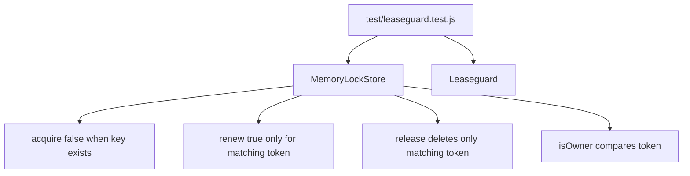

The current tests cover:

- Successful acquire, task execution, release, and hooks.
- Default skip behavior when a lock already exists.
- Throw behavior when a lock is unavailable.
- Retry behavior before acquisition succeeds.
- Timeout behavior, abort signaling, and release after timeout.

## Invariants

- Every successful acquisition has a unique token.
- Renewal and release must only succeed for the current owner token.
- The task receives a context tied to the acquired key and token.
- Renewal stops after task completion, task failure, timeout, release, or renewal failure.
- Release is attempted in `finally` whenever `run()` acquired a handle.
- Store implementations must preserve the `LockStore` ownership semantics.
